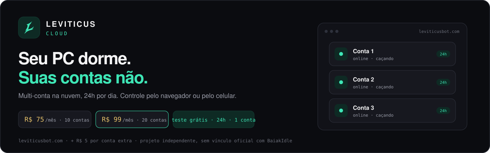
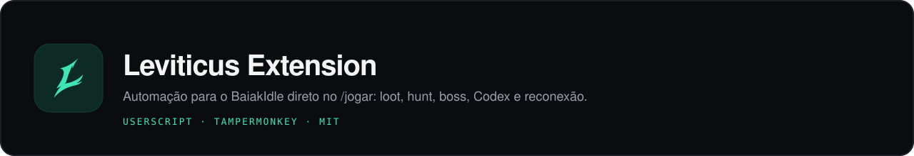

<div align="center">

<a href="https://www.leviticusbot.com/?camp=p2CBR4cb">
  
</a>

<br>

<a href="https://www.leviticusbot.com/?camp=p2CBR4cb"></a>
<a href="https://discord.leviticusbot.com"></a>

</div>

<br>

# ☁️ Leviticus Cloud

> **Liga hoje à noite. Acorda com o loot feito.**
> O Leviticus Cloud roda suas contas de BaiakIdle na nuvem: caça, vende e junta o loot 24h por dia, **com o seu computador desligado**.

<table>
  <tr>
    <td width="33%" valign="top">
      <h4>🗂️ Multi-conta num desk só</h4>
      Todas as suas contas na mesma tela, rodando juntas, cada uma com conexão dedicada.
    </td>
    <td width="33%" valign="top">
      <h4>🔌 Desligue o computador</h4>
      Roda na nuvem: seu PC dorme, suas contas não.
    </td>
    <td width="33%" valign="top">
      <h4>📱 Controle pelo celular</h4>
      Opere tudo pelo navegador do computador ou pelo celular, de onde você estiver.
    </td>
  </tr>
</table>

### 💳 Planos

| Preço | Contas incluídas |
| :--: | :-- |
| **R$ 75,00**/mês | até **10** contas |
| **R$ 99,00**/mês | até **20** contas |
| **R$ 5,00** cada | cada conta extra · assine quantas quiser |

🎁 **Teste grátis por 24 horas em 1 conta**.

<div align="center">

<a href="https://www.leviticusbot.com/?camp=p2CBR4cb"></a>

</div>

<br>

---

<br>

<div align="center">



<br>

[](https://github.com/iIlusion/baiakidle-helper/releases/latest)
[](https://www.leviticusbot.com/?camp=p2CBR4cb)
[](https://discord.leviticusbot.com)
[](LICENSE)

**[⬇️ Instalar a versão mais recente](https://github.com/iIlusion/baiakidle-helper/releases/latest/download/baiakidle-helper.user.js)** · **[☁️ Leviticus Cloud](https://www.leviticusbot.com/?camp=p2CBR4cb)** · **[💬 Discord](https://discord.leviticusbot.com)**

</div>

<br>

O **Leviticus Extension** é o userscript do ecossistema Leviticus: ele adiciona automações próprias direto na sessão do [BaiakIdle](https://baiakidle.com/jogar/), dentro do navegador. Antes se chamava *Baiakidle Helper*.

> [!TIP]
> **Extensão ou Cloud?** A extensão automatiza a aba do jogo que você já tem aberta, então precisa do navegador ligado. Para deixar várias contas rodando **sem o PC ligado** e controlar pelo celular, use o [Leviticus Cloud](https://www.leviticusbot.com/?camp=p2CBR4cb).

## 📑 Índice

- [✨ O que a extensão faz](#-o-que-a-extensão-faz)
- [📦 Instalação](#-instalação)
- [🚀 Primeiros passos](#-primeiros-passos)
- [🛠️ Solução de problemas](#️-solução-de-problemas)
- [👩‍💻 Desenvolvimento](#-desenvolvimento)
- [🔒 Privacidade e uso](#-privacidade-e-uso)

---

## ✨ O que a extensão faz

Tudo fica reunido na aba **Leviticus** da barra superior do jogo. Por padrão só **Auto Sell** e **Open All Glooth Bag** começam ligados; o resto fica desligado até você ativar.

### 🎒 Loot e inventário

| Recurso | O que faz |
| :-- | :-- |
| **Auto Sell** | Vende quando a Loot Pouch chega ao limite (1–100%) que você definir. |
| **Auto Transfer** | Move itens da Loot Pouch para o Backpack por raridade (Rare, Epic, Legendary, Mythical). |
| **Open All Glooth Bag** | Abre as bags quando há espaço disponível. |
| **Auto Sell Supply Potions** | Organiza e vende as potions da Supply Pouch, com travas opcionais (só no Treino, só sem Glooth, só com loot vazio). |

### ⚔️ Hunt e stamina

| Recurso | O que faz |
| :-- | :-- |
| **Auto Hunt** | Entra na hunt escolhida pelo catálogo do jogo. |
| **Treino por stamina** | Alterna entre hunt e Treino online por dois limites de stamina (vai ao Treino abaixo de um, volta à hunt acima do outro). |
| **Rota completa** | Transfere itens e vende a pouch antes de voltar para a hunt. |

### 👹 Auto Boss próprio

Um Auto Boss do Leviticus dentro do modal de **Bosses** do jogo (não usa o Auto Boss nativo, presets, preparação nem AutoBuild).

- monte a lista de bosses e **arraste os cards** para trocar a ordem;
- remova bosses da fila, **inicie e pare** quando quiser;
- ative o **início automático diário às 00:00 (horário de Brasília)**;
- acompanhe o estado atual no cabeçalho da wave.

### 📖 Leviticus Auto Codex

Uma aba **Leviticus Auto Codex** dentro do menu **Codex** do jogo entrega itens sozinha nas entradas que você escolher.

- cada entrada ainda não concluída ganha um botão **Auto** na lista do Codex;
- na aba, a **ordem é a prioridade**: quando duas entradas disputam o mesmo item, a de cima leva (arraste para reordenar);
- a cada **10 segundos** ele confere as bags e entrega o que servir;
- **nunca** usa item de raridade maior que a pedida e **nunca** paga desbloqueio;
- até **30 entradas** na fila.

> [!WARNING]
> Os itens entregues ao Codex são **destruídos** e não há como desfazer. Revise a fila antes de ligar.

### 🌐 Sessão e interface

| Recurso | O que faz |
| :-- | :-- |
| **Auto Reconnect** | Recupera a sessão em quedas, manutenção e limite de contas simultâneas. |
| **Auto Market Announce** | Publica seus anúncios no Market pelo fluxo normal da página. |
| **Painel Leviticus** | Reúne todas as opções numa aba só e salva as preferências no navegador. |

---

## 📦 Instalação

### 1. Instale o Tampermonkey

Adicione o [Tampermonkey](https://www.tampermonkey.net/) ao seu navegador. Se ele pedir a permissão **Allow User Scripts**, ative.

### 2. Instale a extensão

<div align="center">

<a href="https://github.com/iIlusion/baiakidle-helper/releases/latest/download/baiakidle-helper.user.js"></a>

</div>

Na tela do Tampermonkey, confira se o nome é **Leviticus Extension** e clique em **Install**.

### 3. Abra o jogo

Abra o [BaiakIdle](https://baiakidle.com/jogar/), recarregue a página e procure a aba **Leviticus** na barra superior.

<details>
<summary><b>Já usava o Baiakidle Helper?</b></summary>

<br>

O Tampermonkey pode manter a cópia antiga separada por causa da mudança de nome. Para não rodar duas automações ao mesmo tempo:

1. Abra o painel do Tampermonkey.
2. Desative ou remova o script antigo **Baiakidle Helper**.
3. Deixe só o **Leviticus Extension** ativo.
4. Recarregue a página do jogo.

</details>

<details>
<summary><b>Como atualizar</b></summary>

<br>

A instalação oficial já configura o endereço de atualização: o Tampermonkey verifica novas releases no intervalo que ele mesmo define. Para atualizar na hora, abra de novo o [instalador mais recente](https://github.com/iIlusion/baiakidle-helper/releases/latest/download/baiakidle-helper.user.js) e confirme.

</details>

---

## 🚀 Primeiros passos

1. **Abra a aba Leviticus** na barra superior do jogo e ligue o que quiser. Comece pelo **Auto Sell** e ajuste o limite da pouch.
2. **Auto Hunt:** escolha a hunt na lista, ligue o recurso e, se quiser, ative o Treino por stamina.
3. **Auto Boss:** abra o modal de **Bosses**, entre na aba **Leviticus**, adicione os bosses, arraste para ordenar e clique em iniciar.
4. **Auto Codex:** abra o menu **Codex**, clique em **Auto** nas entradas desejadas, vá para a aba **Leviticus Auto Codex**, defina a prioridade e ligue o botão.

> [!NOTE]
> O aviso do Leviticus Cloud aparece sempre que o jogo abre. Para parar de ver, clique em **Não mostrar novamente**.

---

## 🛠️ Solução de problemas

<details>
<summary><b>A aba Leviticus não apareceu</b></summary>

<br>

- o Tampermonkey está ativo no navegador;
- o script **Leviticus Extension** está habilitado;
- a permissão **Allow User Scripts** está ativa, quando existir;
- o script antigo e o loader de desenvolvimento não estão rodando junto;
- a página foi recarregada depois da instalação.

</details>

<details>
<summary><b>O Auto Codex não entrega nada</b></summary>

<br>

- o botão da aba está em **Ligado** e há entradas na fila;
- o menu Codex está liberado para a conta;
- as bags têm item que serve **na raridade pedida** (itens de raridade maior não são usados);
- a entrada não pede desbloqueio com gold (o Auto Codex não paga desbloqueio).

</details>

---

## 👩‍💻 Desenvolvimento

Requisitos: Node.js 20+ e npm.

```bash
git clone https://github.com/iIlusion/baiakidle-helper.git
cd baiakidle-helper
npm install
npm run build
```

O build gera em `dist/`:

| Arquivo | Uso |
| :-- | :-- |
| `baiakidle-helper.user.js` | versão normal, pronta para o Tampermonkey |
| `baiakidle-helper.dev.user.js` | loader para desenvolvimento local |

**Atualização contínua:** instale o loader dev, desative a versão normal, rode `npm run dev` e recarregue a página a cada alteração (o loader busca o bundle em `http://127.0.0.1:8946`).

```bash
npm run dev        # build em watch + servidor local na porta 8946
npm run build      # userscripts de produção e desenvolvimento
npm run typecheck  # valida o TypeScript sem gerar arquivos
npm run test       # checagens leves e testes
```

**MCP opcional:** para inspecionar DOM, requisições e pacotes WebSocket do jogo com o Codex, use o projeto separado [baiakidle-mcp](https://github.com/iIlusion/baiakidle-mcp). É uma ferramenta de desenvolvimento, não é necessária para usar as automações.

---

## 🔒 Privacidade e uso

O Leviticus Extension roda só nas páginas do BaiakIdle correspondentes ao userscript. As preferências ficam no `localStorage` do navegador, sem telemetria e sem depender de servidor externo para executar as automações.

Projeto independente, **sem vínculo oficial com o BaiakIdle**. Use na sua própria sessão e confira as regras do jogo.

<div align="center">

<br>

**[☁️ Leviticus Cloud](https://www.leviticusbot.com/?camp=p2CBR4cb)** · **[💬 Discord](https://discord.leviticusbot.com)** · **[📄 Licença MIT](LICENSE)**

</div>
